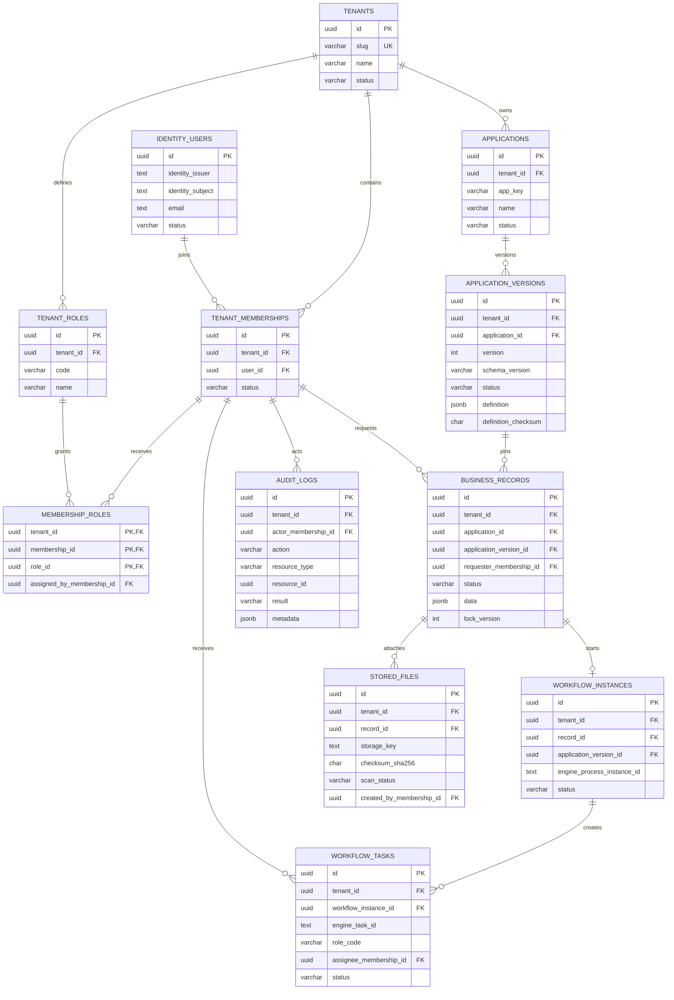

# DigiX database foundation

Tài liệu này mô tả schema được triển khai bởi migration
`0001_initial_schema`. Nguồn chân lý của schema là mã migration tại
`apps/api/src/database/migrations/0001-initial-schema.ts`; sơ đồ dưới đây giúp
review quan hệ và không thay thế migration.

## ERD



## Mục đích các nhóm bảng

- `tenants`, `identity_users`, `tenant_memberships`, `tenant_roles` và
  `membership_roles` tách danh tính toàn cục khỏi tư cách thành viên và quyền
  trong từng doanh nghiệp.
- `applications` và `application_versions` lưu ứng dụng được cấu hình theo
  tenant. Phiên bản ứng dụng chứa definition JSON, checksum và định danh
  workflow sau khi publish.
- `business_records` lưu hồ sơ động bằng JSONB và ghim mỗi hồ sơ vào đúng
  application version.
- `workflow_instances` và `workflow_tasks` là bản tham chiếu/bản chiếu để nối
  hồ sơ với workflow engine và dựng inbox; Flowable chưa được tích hợp ở lát cắt
  hiện tại.
- `stored_files` chỉ lưu metadata, checksum và trạng thái quét. Nội dung tệp và
  kho đối tượng chưa được triển khai.
- `audit_logs` lưu actor, action, resource, result và metadata. API ghi audit
  nghiệp vụ chưa được triển khai.

## Tenant isolation ở lớp dữ liệu

Mọi bảng thuộc doanh nghiệp có `tenant_id NOT NULL`. Quan hệ giữa các bảng
tenant-owned sử dụng khóa ngoại tổng hợp, ví dụ:

```sql
FOREIGN KEY (tenant_id, application_id)
REFERENCES applications (tenant_id, id)
```

Cơ chế này khiến PostgreSQL từ chối một bản ghi tenant A tham chiếu application,
role, membership, record hoặc actor của tenant B. Đây là lớp phòng vệ dữ liệu;
API vẫn phải lấy tenant từ danh tính đã xác thực và áp dụng tenant guard trên
mọi truy vấn. RLS/API guard chưa thuộc checkpoint này.

`tenantId` dạng chuỗi trong manifest Builder, ví dụ `tenant_beta`, dự kiến ánh
xạ tới `tenants.slug`. API phải resolve slug sang UUID `tenants.id` và không
được tin `tenantId` do client gửi để quyết định quyền.

## Chính sách migration

- Migration ID có dạng `NNNN_lowercase_name` và được đăng ký theo thứ tự trong
  `apps/api/src/database/migrations.ts`.
- Migration đã áp dụng là append-only; không sửa nội dung cũ. Thay đổi schema
  phải được thêm bằng migration mới.
- Runner lưu ID, SHA-256 checksum và thời điểm áp dụng trong
  `schema_migrations`.
- Mỗi lần chạy dùng transaction và PostgreSQL advisory lock. Lỗi làm rollback
  toàn bộ lần chạy; checksum khác làm runner dừng.
- Compose chạy migration trước khi khởi động API. Migration lỗi khiến API không
  được báo healthy.

## Chạy và kiểm chứng

Khởi động toàn bộ hệ thống từ thư mục gốc:

```sh
docker compose up --build --wait
```

Chạy lại migration production trong container:

```sh
docker compose exec api node dist/database/migrate.js
```

Xem lịch sử migration:

```sh
docker compose exec db sh -c \
  'psql -U "$POSTGRES_USER" -d "$POSTGRES_DB" -c "SELECT id, checksum, applied_at FROM schema_migrations ORDER BY id"'
```

Kiểm chứng schema và tenant isolation:

```sh
docker compose exec api node dist/database/verify-schema.js
```

Verification tạo dữ liệu Alpha/Beta trong transaction, xác nhận sáu liên kết
chéo tenant bị PostgreSQL từ chối với lỗi foreign key, sau đó rollback và kiểm
tra không còn dữ liệu thử.

Khi phát triển API ngoài container và đã có đường kết nối tới PostgreSQL:

```sh
cd apps/api
npm run db:migrate
npm run db:verify
```

## Giới hạn hiện tại

Schema và constraint đã chạy trên PostgreSQL 17, nhưng chưa có API nghiệp vụ,
tenant guard, RLS, seed tenant cố định, Keycloak, Gateway, kho tệp hoặc Flowable.
Không coi schema này là bằng chứng MVP đầu-cuối đã hoàn thành.
