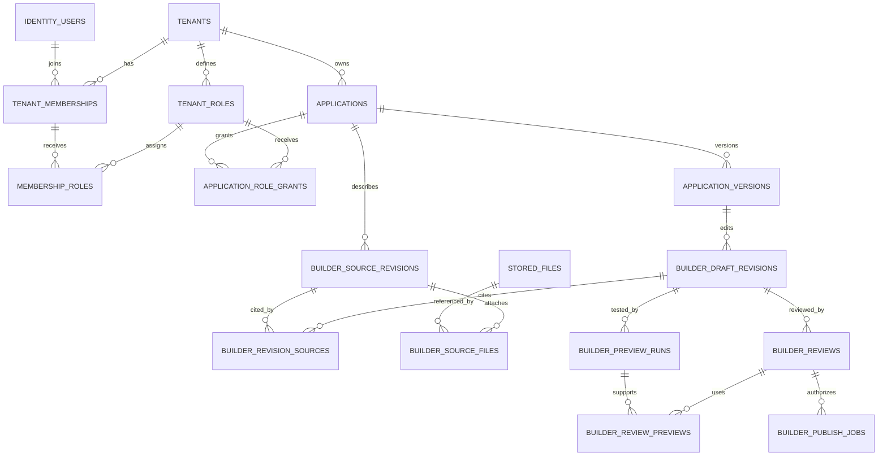
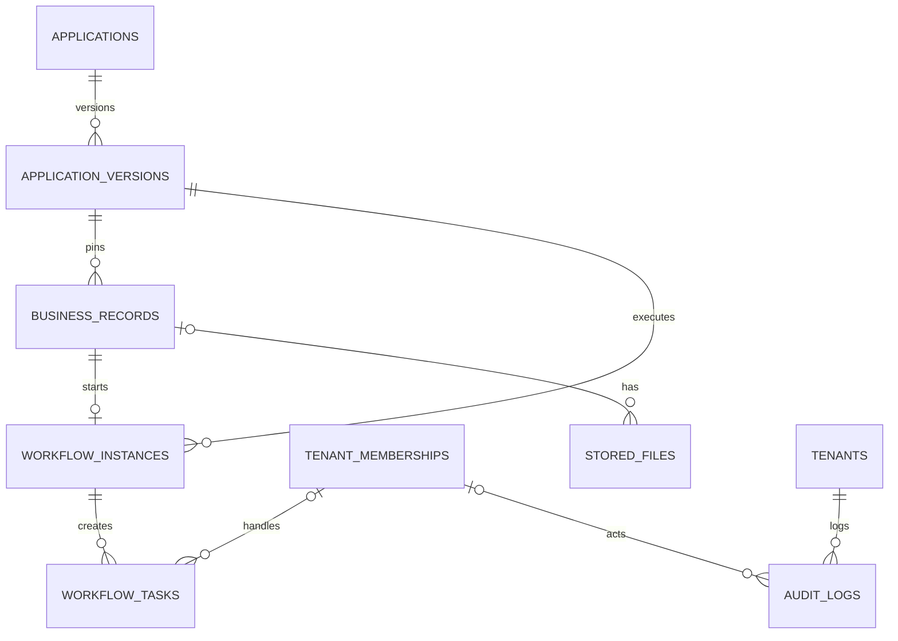
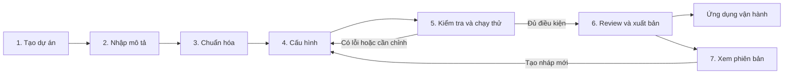

# DigiX Lab — Database, luồng hoạt động và kịch bản demo Builder

Bản Markdown tổng hợp gồm **12 bảng hiện có** trong migration `0001_initial_schema` và **9 bảng đề xuất** cho Builder. Dấu `*` đánh dấu cột đề xuất bổ sung vào bảng hiện có.

## 1. Sơ đồ quan hệ

| Quan hệ | Số lượng | Cột liên kết hoặc quy tắc |
| --- | --- | --- |
| Tenant → Ứng dụng → Phiên bản → Lần lưu nháp | 1:N ở từng cấp | `tenant_id`, `application_id`, `application_version_id`. |
| Ứng dụng → Phiên bản hiện hành | 1:0..1 | `applications.current_version_id` trỏ tới một phiên `published` của chính app. App mới có giá trị NULL. |
| Phiên bản → Lần lưu đang dùng | 1:0..1 | `application_versions.current_revision_id` trỏ tới revision của chính phiên bản. Giữ nguyên con trỏ khi xuất bản. |
| Lần lưu nháp ↔ Mô tả gốc | N:M | `builder_revision_sources` giữ danh sách revision nguồn dùng trong snapshot. |
| Mô tả gốc ↔ Tệp | N:M | `builder_source_files` tham chiếu `stored_files` khi bật nguồn tệp. |
| Lần lưu nháp → Chạy thử và review | 1:N | `revision_id` xác định đúng lần lưu đã được thử hoặc review. |
| Review ↔ Lượt chạy thử | N:M | `builder_review_previews` giữ bằng chứng, cùng `revision_id` ở cả hai đầu. |
| Review → Tác vụ xuất bản | 1:N | Chỉ review có quyết định `approved` mới mở tác vụ. Retry cùng khóa dùng lại một tác vụ. |
| Vai trò tenant ↔ Ứng dụng | N:M | `application_role_grants` cấp từng quyền. Thành viên nhận role qua `membership_roles`. |
| Phiên bản → Hồ sơ → Workflow → Task | 1:N, 1:0..1, 1:N | Hồ sơ giữ phiên bản từ lúc tạo. Hộp việc đọc task thuộc workflow của hồ sơ. |

## 2. Từ điển dữ liệu

Mỗi trường có một dòng riêng. **PK** là khóa chính, **FK** là khóa ngoại, **UQ** là ràng buộc duy nhất. Ký hiệu trong cột Khóa cho biết trường tham gia khóa. Danh sách dưới mỗi bảng ghi đầy đủ tổ hợp cột.

### `tenants` · Hiện có

| Tên trường | Kiểu PostgreSQL | Cho phép NULL | Khóa | Ý nghĩa |
| --- | --- | --- | --- | --- |
| `id` | `uuid` | Không | PK | Định danh bản ghi. |
| `slug` | `varchar(64)` | Không | UQ | Mã tenant. |
| `name` | `varchar(160)` | Không | — | Tên hiển thị. |
| `status` | `varchar(20)` | Không | — | Trạng thái vòng đời. |
| `created_at` | `timestamptz` | Không | — | Thời điểm tạo. |
| `updated_at` | `timestamptz` | Không | — | Thời điểm cập nhật. |

- **PK** `(id)`.
- **UQ** `(slug)`.

### `identity_users` · Hiện có

| Tên trường | Kiểu PostgreSQL | Cho phép NULL | Khóa | Ý nghĩa |
| --- | --- | --- | --- | --- |
| `id` | `uuid` | Không | PK | Định danh bản ghi. |
| `identity_issuer` | `text` | Không | UQ | Issuer OIDC. |
| `identity_subject` | `text` | Không | UQ | Subject do nhà cung cấp định danh cấp. |
| `email` | `text` | Có | — | Email người dùng. |
| `display_name` | `varchar(160)` | Có | — | Tên người dùng. |
| `status` | `varchar(20)` | Không | — | Trạng thái vòng đời. |
| `created_at` | `timestamptz` | Không | — | Thời điểm tạo. |
| `updated_at` | `timestamptz` | Không | — | Thời điểm cập nhật. |

- **PK** `(id)`.
- **UQ** `(identity_issuer, identity_subject)`.

### `tenant_memberships` · Hiện có

| Tên trường | Kiểu PostgreSQL | Cho phép NULL | Khóa | Ý nghĩa |
| --- | --- | --- | --- | --- |
| `id` | `uuid` | Không | PK, UQ | Định danh bản ghi. |
| `tenant_id` | `uuid` | Không | FK, UQ | Tenant sở hữu dữ liệu. |
| `user_id` | `uuid` | Không | FK, UQ | Người dùng thuộc tenant. |
| `status` | `varchar(20)` | Không | — | Trạng thái vòng đời. |
| `joined_at` | `timestamptz` | Không | — | Thời điểm tham gia tenant. |
| `updated_at` | `timestamptz` | Không | — | Thời điểm cập nhật. |

- **PK** `(id)`.
- **FK** `(tenant_id)` → `tenants(id)`.
- **FK** `(user_id)` → `identity_users(id)`.
- **UQ** `(tenant_id, user_id)`.
- **UQ** `(tenant_id, id)`.

### `tenant_roles` · Hiện có

| Tên trường | Kiểu PostgreSQL | Cho phép NULL | Khóa | Ý nghĩa |
| --- | --- | --- | --- | --- |
| `id` | `uuid` | Không | PK, UQ | Định danh bản ghi. |
| `tenant_id` | `uuid` | Không | FK, UQ | Tenant sở hữu dữ liệu. |
| `code` | `varchar(64)` | Không | UQ | Mã vai trò. |
| `name` | `varchar(120)` | Không | — | Tên hiển thị. |
| `description` | `text` | Có | — | Mô tả vai trò. |
| `is_system` | `boolean` | Không | — | Đánh dấu vai trò hệ thống. |
| `created_at` | `timestamptz` | Không | — | Thời điểm tạo. |
| `updated_at` | `timestamptz` | Không | — | Thời điểm cập nhật. |

- **PK** `(id)`.
- **FK** `(tenant_id)` → `tenants(id)`.
- **UQ** `(tenant_id, code)`.
- **UQ** `(tenant_id, id)`.

### `membership_roles` · Hiện có

| Tên trường | Kiểu PostgreSQL | Cho phép NULL | Khóa | Ý nghĩa |
| --- | --- | --- | --- | --- |
| `tenant_id` | `uuid` | Không | PK, FK | Tenant sở hữu dữ liệu. |
| `membership_id` | `uuid` | Không | PK, FK | Thành viên được gán vai trò. |
| `role_id` | `uuid` | Không | PK, FK | Vai trò được cấp. |
| `assigned_by_membership_id` | `uuid` | Có | FK | Thành viên thực hiện thao tác gán. |
| `assigned_at` | `timestamptz` | Không | — | Thời điểm gán vai trò. |

- **FK** `(tenant_id)` → `tenants(id)`.
- **PK** `(tenant_id, membership_id, role_id)`.
- **FK** `(tenant_id, membership_id)` → `tenant_memberships(tenant_id, id)`.
- **FK** `(tenant_id, role_id)` → `tenant_roles(tenant_id, id)`.
- **FK** `(tenant_id, assigned_by_membership_id)` → `tenant_memberships(tenant_id, id)`.

### `applications` · Hiện có

| Tên trường | Kiểu PostgreSQL | Cho phép NULL | Khóa | Ý nghĩa |
| --- | --- | --- | --- | --- |
| `id` | `uuid` | Không | PK, UQ | Định danh bản ghi. |
| `tenant_id` | `uuid` | Không | FK, UQ | Tenant sở hữu dữ liệu. |
| `app_key` | `varchar(64)` | Không | UQ | Mã ứng dụng, ví dụ leave_request. |
| `name` | `varchar(160)` | Không | — | Tên hiển thị. |
| `status` | `varchar(20)` | Không | — | Trạng thái vòng đời. |
| `created_at` | `timestamptz` | Không | — | Thời điểm tạo. |
| `updated_at` | `timestamptz` | Không | — | Thời điểm cập nhật. |
| `goal` * | `text` | Có | — | Mục tiêu nghiệp vụ. |
| `department_refs` * | `jsonb` | Không | — | Danh sách bộ phận liên quan. |
| `template_key` * | `varchar(64)` | Có | — | Mã mẫu khởi tạo. |
| `current_version_id` * | `uuid` | Có | FK | Phiên bản áp dụng cho hồ sơ mới. |

- **PK** `(id)`.
- **FK** `(tenant_id)` → `tenants(id)`.
- **UQ** `(tenant_id, app_key)`.
- **UQ** `(tenant_id, id)`.

Khóa của các cột đề xuất có dấu `*`.

- **FK** `(tenant_id, id, current_version_id)` → `application_versions(tenant_id, application_id, id)`.

### `application_versions` · Hiện có

| Tên trường | Kiểu PostgreSQL | Cho phép NULL | Khóa | Ý nghĩa |
| --- | --- | --- | --- | --- |
| `id` | `uuid` | Không | PK, UQ | Định danh bản ghi. |
| `tenant_id` | `uuid` | Không | FK, UQ | Tenant sở hữu dữ liệu. |
| `application_id` | `uuid` | Không | FK, UQ | Ứng dụng thuộc tenant. |
| `version` | `integer` | Không | UQ | Số phiên bản ứng dụng. |
| `schema_version` | `varchar(20)` | Không | — | Phiên bản định dạng manifest. |
| `status` | `varchar(32)` | Không | — | Trạng thái vòng đời. |
| `definition` | `jsonb` | Không | — | Manifest JSON. |
| `definition_checksum` | `char(64)` | Không | — | SHA-256 của manifest. |
| `workflow_deployment_id` | `text` | Có | — | Mã triển khai do workflow engine trả. |
| `workflow_definition_id` | `text` | Có | — | Mã định nghĩa workflow do engine trả. |
| `created_by_membership_id` | `uuid` | Không | FK | Thành viên tạo bản ghi. |
| `reviewed_by_membership_id` | `uuid` | Có | FK | Thành viên review. |
| `published_by_membership_id` | `uuid` | Có | FK | Thành viên xuất bản. |
| `created_at` | `timestamptz` | Không | — | Thời điểm tạo. |
| `reviewed_at` | `timestamptz` | Có | — | Thời điểm review. |
| `published_at` | `timestamptz` | Có | — | Thời điểm xuất bản. |
| `current_revision_id` * | `uuid` | Có | FK | Lần lưu nháp hiện hành. |
| `based_on_version_id` * | `uuid` | Có | FK | Phiên bản nguồn khi tạo nháp mới. |

- **PK** `(id)`.
- **FK** `(tenant_id)` → `tenants(id)`.
- **UQ** `(tenant_id, application_id, version)`.
- **UQ** `(tenant_id, application_id, id)`.
- **UQ** `(tenant_id, id)`.
- **FK** `(tenant_id, application_id)` → `applications(tenant_id, id)`.
- **FK** `(tenant_id, created_by_membership_id)` → `tenant_memberships(tenant_id, id)`.
- **FK** `(tenant_id, reviewed_by_membership_id)` → `tenant_memberships(tenant_id, id)`.
- **FK** `(tenant_id, published_by_membership_id)` → `tenant_memberships(tenant_id, id)`.

Khóa của các cột đề xuất có dấu `*`.

- **FK** `(tenant_id, application_id, id, current_revision_id)` → `builder_draft_revisions(tenant_id, application_id, application_version_id, id)`.
- **FK** `(tenant_id, application_id, based_on_version_id)` → `application_versions(tenant_id, application_id, id)`.

### `application_role_grants` · Đề xuất

| Tên trường | Kiểu PostgreSQL | Cho phép NULL | Khóa | Ý nghĩa |
| --- | --- | --- | --- | --- |
| `tenant_id` | `uuid` | Không | PK, FK | Tenant sở hữu dữ liệu. |
| `application_id` | `uuid` | Không | PK, FK | Ứng dụng thuộc tenant. |
| `role_id` | `uuid` | Không | PK, FK | Vai trò được cấp. |
| `permission` | `varchar(64)` | Không | PK | Quyền theo app, ví dụ app:publish. |
| `granted_by_membership_id` | `uuid` | Không | FK | Thành viên cấp quyền. |
| `granted_at` | `timestamptz` | Không | — | Thời điểm cấp quyền. |

- **PK** `(tenant_id, application_id, role_id, permission)`.
- **FK** `(tenant_id, application_id)` → `applications(tenant_id, id)`.
- **FK** `(tenant_id, role_id)` → `tenant_roles(tenant_id, id)`.
- **FK** `(tenant_id, granted_by_membership_id)` → `tenant_memberships(tenant_id, id)`.

### `builder_source_revisions` · Đề xuất

| Tên trường | Kiểu PostgreSQL | Cho phép NULL | Khóa | Ý nghĩa |
| --- | --- | --- | --- | --- |
| `id` | `uuid` | Không | PK, UQ | Định danh bản ghi. |
| `tenant_id` | `uuid` | Không | FK, UQ | Tenant sở hữu dữ liệu. |
| `application_id` | `uuid` | Không | FK, UQ | Ứng dụng thuộc tenant. |
| `revision_no` | `integer` | Không | UQ | Số thứ tự lần lưu. |
| `sections` | `jsonb` | Không | — | Mô tả đầu vào, bước, nhánh, kết quả và ngoại lệ. |
| `segments` | `jsonb` | Không | — | Các đoạn nguồn có ID để truy vết. |
| `created_by_membership_id` | `uuid` | Không | FK | Thành viên tạo bản ghi. |
| `created_at` | `timestamptz` | Không | — | Thời điểm tạo. |

- **PK** `(id)`.
- **FK** `(tenant_id, application_id)` → `applications(tenant_id, id)`.
- **UQ** `(tenant_id, application_id, id)`.
- **UQ** `(tenant_id, application_id, revision_no)`.
- **FK** `(tenant_id, created_by_membership_id)` → `tenant_memberships(tenant_id, id)`.

### `builder_source_files` · Đề xuất

| Tên trường | Kiểu PostgreSQL | Cho phép NULL | Khóa | Ý nghĩa |
| --- | --- | --- | --- | --- |
| `tenant_id` | `uuid` | Không | PK, FK | Tenant sở hữu dữ liệu. |
| `application_id` | `uuid` | Không | PK, FK | Ứng dụng thuộc tenant. |
| `source_revision_id` | `uuid` | Không | PK, FK | Revision của mô tả gốc. |
| `file_id` | `uuid` | Không | PK, FK | Tệp nguồn được phép truy cập. |

- **PK** `(tenant_id, application_id, source_revision_id, file_id)`.
- **FK** `(tenant_id, application_id, source_revision_id)` → `builder_source_revisions(tenant_id, application_id, id)`.
- **FK** `(tenant_id, file_id)` → `stored_files(tenant_id, id)`.

Dùng bảng này khi Builder hỗ trợ nguồn tệp. API kiểm tra quyền và `scan_status = clean`.

### `builder_draft_revisions` · Đề xuất

| Tên trường | Kiểu PostgreSQL | Cho phép NULL | Khóa | Ý nghĩa |
| --- | --- | --- | --- | --- |
| `id` | `uuid` | Không | PK, UQ | Định danh bản ghi. |
| `tenant_id` | `uuid` | Không | FK, UQ | Tenant sở hữu dữ liệu. |
| `application_id` | `uuid` | Không | FK, UQ | Ứng dụng thuộc tenant. |
| `application_version_id` | `uuid` | Không | FK, UQ | Phiên bản ứng dụng. |
| `revision_no` | `integer` | Không | UQ | Số thứ tự lần lưu. |
| `definition` | `jsonb` | Không | — | Manifest JSON. |
| `design_metadata` | `jsonb` | Không | — | Nhãn UI, ánh xạ nguồn, quyền và cấu hình. |
| `snapshot_checksum` | `char(64)` | Không | — | SHA-256 của cấu hình và các revision nguồn. |
| `created_by_membership_id` | `uuid` | Không | FK | Thành viên tạo bản ghi. |
| `created_at` | `timestamptz` | Không | — | Thời điểm tạo. |

- **PK** `(id)`.
- **FK** `(tenant_id, application_id, application_version_id)` → `application_versions(tenant_id, application_id, id)`.
- **UQ** `(tenant_id, application_id, application_version_id, id)`.
- **UQ** `(tenant_id, application_id, application_version_id, revision_no)`.
- **FK** `(tenant_id, created_by_membership_id)` → `tenant_memberships(tenant_id, id)`.

### `builder_revision_sources` · Đề xuất

| Tên trường | Kiểu PostgreSQL | Cho phép NULL | Khóa | Ý nghĩa |
| --- | --- | --- | --- | --- |
| `tenant_id` | `uuid` | Không | PK, FK | Tenant sở hữu dữ liệu. |
| `application_id` | `uuid` | Không | PK, FK | Ứng dụng thuộc tenant. |
| `application_version_id` | `uuid` | Không | PK, FK | Phiên bản ứng dụng. |
| `revision_id` | `uuid` | Không | PK, FK | Lần lưu nháp của phiên bản. |
| `source_revision_id` | `uuid` | Không | PK, FK | Revision của mô tả gốc. |

- **PK** `(tenant_id, application_id, application_version_id, revision_id, source_revision_id)`.
- **FK** `(tenant_id, application_id, application_version_id, revision_id)` → `builder_draft_revisions(tenant_id, application_id, application_version_id, id)`.
- **FK** `(tenant_id, application_id, source_revision_id)` → `builder_source_revisions(tenant_id, application_id, id)`.

### `builder_preview_runs` · Đề xuất

| Tên trường | Kiểu PostgreSQL | Cho phép NULL | Khóa | Ý nghĩa |
| --- | --- | --- | --- | --- |
| `id` | `uuid` | Không | PK, UQ | Định danh bản ghi. |
| `tenant_id` | `uuid` | Không | FK, UQ | Tenant sở hữu dữ liệu. |
| `application_id` | `uuid` | Không | FK, UQ | Ứng dụng thuộc tenant. |
| `application_version_id` | `uuid` | Không | FK, UQ | Phiên bản ứng dụng. |
| `revision_id` | `uuid` | Không | FK, UQ | Lần lưu nháp của phiên bản. |
| `mode` | `varchar(20)` | Không | — | Chế độ simulation hoặc engine. |
| `status` | `varchar(20)` | Không | — | Trạng thái vòng đời. |
| `input` | `jsonb` | Không | — | Giá trị biểu mẫu giả lập. |
| `decisions` | `jsonb` | Không | — | Quyết định giả lập theo vai trò. |
| `expected` | `jsonb` | Có | — | Kết quả mong đợi. |
| `result` | `jsonb` | Không | — | Kết quả thao tác hoặc đường đi và trạng thái cuối của lượt thử. |
| `run_by_membership_id` | `uuid` | Không | FK | Thành viên chạy thử. |
| `created_at` | `timestamptz` | Không | — | Thời điểm tạo. |

- **PK** `(id)`.
- **FK** `(tenant_id, application_id, application_version_id, revision_id)` → `builder_draft_revisions(tenant_id, application_id, application_version_id, id)`.
- **UQ** `(tenant_id, application_id, application_version_id, revision_id, id)`.
- **FK** `(tenant_id, run_by_membership_id)` → `tenant_memberships(tenant_id, id)`.

### `builder_reviews` · Đề xuất

| Tên trường | Kiểu PostgreSQL | Cho phép NULL | Khóa | Ý nghĩa |
| --- | --- | --- | --- | --- |
| `id` | `uuid` | Không | PK, UQ | Định danh bản ghi. |
| `tenant_id` | `uuid` | Không | FK, UQ | Tenant sở hữu dữ liệu. |
| `application_id` | `uuid` | Không | FK, UQ | Ứng dụng thuộc tenant. |
| `application_version_id` | `uuid` | Không | FK, UQ | Phiên bản ứng dụng. |
| `revision_id` | `uuid` | Không | FK, UQ | Lần lưu nháp của phiên bản. |
| `decision` | `varchar(24)` | Không | — | approved hoặc changes_requested. |
| `note` | `text` | Có | — | Ghi chú review. |
| `reviewed_by_membership_id` | `uuid` | Không | FK | Thành viên review. |
| `reviewed_at` | `timestamptz` | Không | — | Thời điểm review. |

- **PK** `(id)`.
- **FK** `(tenant_id, application_id, application_version_id, revision_id)` → `builder_draft_revisions(tenant_id, application_id, application_version_id, id)`.
- **UQ** `(tenant_id, application_id, application_version_id, revision_id, id)`.
- **FK** `(tenant_id, reviewed_by_membership_id)` → `tenant_memberships(tenant_id, id)`.

### `builder_review_previews` · Đề xuất

| Tên trường | Kiểu PostgreSQL | Cho phép NULL | Khóa | Ý nghĩa |
| --- | --- | --- | --- | --- |
| `tenant_id` | `uuid` | Không | PK, FK | Tenant sở hữu dữ liệu. |
| `application_id` | `uuid` | Không | PK, FK | Ứng dụng thuộc tenant. |
| `application_version_id` | `uuid` | Không | PK, FK | Phiên bản ứng dụng. |
| `revision_id` | `uuid` | Không | PK, FK | Lần lưu nháp của phiên bản. |
| `review_id` | `uuid` | Không | PK, FK | Lần review của cùng snapshot. |
| `preview_id` | `uuid` | Không | PK, FK | Lượt chạy thử được dùng làm bằng chứng. |

- **PK** `(tenant_id, application_id, application_version_id, revision_id, review_id, preview_id)`.
- **FK** `(tenant_id, application_id, application_version_id, revision_id, review_id)` → `builder_reviews(tenant_id, application_id, application_version_id, revision_id, id)`.
- **FK** `(tenant_id, application_id, application_version_id, revision_id, preview_id)` → `builder_preview_runs(tenant_id, application_id, application_version_id, revision_id, id)`.

### `builder_publish_jobs` · Đề xuất

| Tên trường | Kiểu PostgreSQL | Cho phép NULL | Khóa | Ý nghĩa |
| --- | --- | --- | --- | --- |
| `id` | `uuid` | Không | PK | Định danh bản ghi. |
| `tenant_id` | `uuid` | Không | FK, UQ | Tenant sở hữu dữ liệu. |
| `application_id` | `uuid` | Không | FK, UQ | Ứng dụng thuộc tenant. |
| `application_version_id` | `uuid` | Không | FK | Phiên bản ứng dụng. |
| `revision_id` | `uuid` | Không | FK | Lần lưu nháp của phiên bản. |
| `review_id` | `uuid` | Không | FK | Lần review của cùng snapshot. |
| `idempotency_key` | `text` | Không | UQ | Khóa retry cùng yêu cầu. |
| `status` | `varchar(32)` | Không | — | Trạng thái vòng đời. |
| `workflow_deployment_id` | `text` | Có | — | Mã triển khai do workflow engine trả. |
| `workflow_definition_id` | `text` | Có | — | Mã định nghĩa workflow do engine trả. |
| `requested_by_membership_id` | `uuid` | Không | FK | Publisher yêu cầu phát hành. |
| `created_at` | `timestamptz` | Không | — | Thời điểm tạo. |
| `updated_at` | `timestamptz` | Không | — | Thời điểm cập nhật. |
| `error_code` | `text` | Có | — | Mã lỗi hoặc đối soát. |

- **PK** `(id)`.
- **FK** `(tenant_id, application_id, application_version_id, revision_id, review_id)` → `builder_reviews(tenant_id, application_id, application_version_id, revision_id, id)`.
- **UQ** `(tenant_id, application_id, idempotency_key)`.
- **FK** `(tenant_id, requested_by_membership_id)` → `tenant_memberships(tenant_id, id)`.

### `business_records` · Hiện có

| Tên trường | Kiểu PostgreSQL | Cho phép NULL | Khóa | Ý nghĩa |
| --- | --- | --- | --- | --- |
| `id` | `uuid` | Không | PK, UQ | Định danh bản ghi. |
| `tenant_id` | `uuid` | Không | FK, UQ | Tenant sở hữu dữ liệu. |
| `application_id` | `uuid` | Không | FK | Ứng dụng thuộc tenant. |
| `application_version_id` | `uuid` | Không | FK | Phiên bản ứng dụng. |
| `requester_membership_id` | `uuid` | Không | FK | Thành viên tạo hồ sơ. |
| `status` | `varchar(32)` | Không | — | Trạng thái vòng đời. |
| `data` | `jsonb` | Không | — | Giá trị biểu mẫu theo schema đã ghim. |
| `lock_version` | `integer` | Không | — | Số dùng để phát hiện sửa đồng thời. |
| `created_at` | `timestamptz` | Không | — | Thời điểm tạo. |
| `updated_at` | `timestamptz` | Không | — | Thời điểm cập nhật. |
| `submitted_at` | `timestamptz` | Có | — | Thời điểm gửi hồ sơ. |
| `completed_at` | `timestamptz` | Có | — | Thời điểm hoàn tất. |

- **PK** `(id)`.
- **FK** `(tenant_id)` → `tenants(id)`.
- **UQ** `(tenant_id, id)`.
- **FK** `(tenant_id, application_id)` → `applications(tenant_id, id)`.
- **FK** `(tenant_id, application_id, application_version_id)` → `application_versions(tenant_id, application_id, id)`.
- **FK** `(tenant_id, requester_membership_id)` → `tenant_memberships(tenant_id, id)`.

### `workflow_instances` · Hiện có

| Tên trường | Kiểu PostgreSQL | Cho phép NULL | Khóa | Ý nghĩa |
| --- | --- | --- | --- | --- |
| `id` | `uuid` | Không | PK, UQ | Định danh bản ghi. |
| `tenant_id` | `uuid` | Không | FK, UQ | Tenant sở hữu dữ liệu. |
| `record_id` | `uuid` | Không | FK, UQ | Hồ sơ liên quan. |
| `application_version_id` | `uuid` | Không | FK | Phiên bản ứng dụng. |
| `engine_process_instance_id` | `text` | Không | UQ | Mã phiên thực thi của engine. |
| `status` | `varchar(32)` | Không | — | Trạng thái vòng đời. |
| `started_at` | `timestamptz` | Không | — | Thời điểm bắt đầu. |
| `completed_at` | `timestamptz` | Có | — | Thời điểm hoàn tất. |

- **PK** `(id)`.
- **FK** `(tenant_id)` → `tenants(id)`.
- **UQ** `(tenant_id, engine_process_instance_id)`.
- **UQ** `(tenant_id, record_id)`.
- **UQ** `(tenant_id, id)`.
- **FK** `(tenant_id, record_id)` → `business_records(tenant_id, id)`.
- **FK** `(tenant_id, application_version_id)` → `application_versions(tenant_id, id)`.

### `workflow_tasks` · Hiện có

| Tên trường | Kiểu PostgreSQL | Cho phép NULL | Khóa | Ý nghĩa |
| --- | --- | --- | --- | --- |
| `id` | `uuid` | Không | PK, UQ | Định danh bản ghi. |
| `tenant_id` | `uuid` | Không | FK, UQ | Tenant sở hữu dữ liệu. |
| `workflow_instance_id` | `uuid` | Không | FK | Phiên workflow sinh task. |
| `engine_task_id` | `text` | Không | UQ | Mã task do engine cấp. |
| `role_code` | `varchar(64)` | Không | — | Mã vai trò đủ điều kiện xử lý. |
| `assignee_membership_id` | `uuid` | Có | FK | Thành viên được giao task. |
| `status` | `varchar(20)` | Không | — | Trạng thái vòng đời. |
| `created_at` | `timestamptz` | Không | — | Thời điểm tạo. |
| `due_at` | `timestamptz` | Có | — | Hạn xử lý task. |
| `completed_at` | `timestamptz` | Có | — | Thời điểm hoàn tất. |

- **PK** `(id)`.
- **FK** `(tenant_id)` → `tenants(id)`.
- **UQ** `(tenant_id, engine_task_id)`.
- **UQ** `(tenant_id, id)`.
- **FK** `(tenant_id, workflow_instance_id)` → `workflow_instances(tenant_id, id)`.
- **FK** `(tenant_id, assignee_membership_id)` → `tenant_memberships(tenant_id, id)`.

### `stored_files` · Hiện có

| Tên trường | Kiểu PostgreSQL | Cho phép NULL | Khóa | Ý nghĩa |
| --- | --- | --- | --- | --- |
| `id` | `uuid` | Không | PK, UQ | Định danh bản ghi. |
| `tenant_id` | `uuid` | Không | FK, UQ | Tenant sở hữu dữ liệu. |
| `record_id` | `uuid` | Có | FK | Hồ sơ liên quan. |
| `storage_key` | `text` | Không | UQ | Khóa đối tượng trong kho tệp. |
| `original_name` | `text` | Không | — | Tên tệp lúc tải lên. |
| `content_type` | `text` | Không | — | Kiểu nội dung của tệp. |
| `size_bytes` | `bigint` | Không | — | Kích thước tính theo byte. |
| `checksum_sha256` | `char(64)` | Không | — | SHA-256 của nội dung tệp. |
| `scan_status` | `varchar(20)` | Không | — | Trạng thái quét tệp. |
| `created_by_membership_id` | `uuid` | Không | FK | Thành viên tạo bản ghi. |
| `created_at` | `timestamptz` | Không | — | Thời điểm tạo. |

- **PK** `(id)`.
- **FK** `(tenant_id)` → `tenants(id)`.
- **UQ** `(tenant_id, storage_key)`.
- **UQ** `(tenant_id, id)`.
- **FK** `(tenant_id, record_id)` → `business_records(tenant_id, id)`.
- **FK** `(tenant_id, created_by_membership_id)` → `tenant_memberships(tenant_id, id)`.

### `audit_logs` · Hiện có

| Tên trường | Kiểu PostgreSQL | Cho phép NULL | Khóa | Ý nghĩa |
| --- | --- | --- | --- | --- |
| `id` | `uuid` | Không | PK, UQ | Định danh bản ghi. |
| `tenant_id` | `uuid` | Không | FK, UQ | Tenant sở hữu dữ liệu. |
| `actor_membership_id` | `uuid` | Có | FK | Thành viên thực hiện, nếu xác định được. |
| `action` | `varchar(120)` | Không | — | Mã hành động. |
| `resource_type` | `varchar(80)` | Không | — | Loại đối tượng chịu tác động. |
| `resource_id` | `uuid` | Có | — | ID đối tượng dùng để tra cứu. |
| `result` | `varchar(20)` | Không | — | Kết quả thao tác hoặc đường đi và trạng thái cuối của lượt thử. |
| `metadata` | `jsonb` | Không | — | Thông tin bổ sung để tra cứu. |
| `occurred_at` | `timestamptz` | Không | — | Thời điểm xảy ra sự kiện. |

- **PK** `(id)`.
- **FK** `(tenant_id)` → `tenants(id)`.
- **UQ** `(tenant_id, id)`.
- **FK** `(tenant_id, actor_membership_id)` → `tenant_memberships(tenant_id, id)`.

## 3. Luồng hoạt động

### Dữ liệu vào và ra

#### Dữ liệu người dùng cung cấp

- **Thông tin ứng dụng** gồm tên, mã ứng dụng, mục tiêu, bộ phận liên quan và cách bắt đầu từ đầu hoặc từ mẫu. Với mẫu mua sắm, API sao chép cấu hình vào nháp riêng của tenant.
- **Mô tả gốc** gồm dữ liệu cần thu, các bước, người chịu trách nhiệm, điều kiện, kết quả và ngoại lệ. Có thể nhập trực tiếp hoặc tham chiếu tệp đã được API cho phép. Ví dụ nghỉ phép dùng văn bản nhập tay nên có thể chạy khi kho tệp chưa sẵn sàng.
- **Cấu hình có cấu trúc** gồm vai trò ứng dụng, kiểu và giới hạn trường, bước, người xử lý, điều kiện rẽ nhánh và trạng thái kết thúc. Designer kiểm tra và bổ sung các chỗ chưa rõ.
- **Dữ liệu chạy thử** gồm giá trị biểu mẫu giả lập, vai trò thực hiện từng quyết định và kết quả mong đợi. Dữ liệu thử được gắn với bản nháp đã lưu.
- **Xác nhận phát hành** gồm phiên bản và dấu kiểm tra của bản nháp đã review, cùng ghi chú nếu có. Chỉ người có quyền phát hành ứng dụng mới thực hiện được.

#### Dữ liệu Builder sinh ra

- **Bản mô tả gốc và ánh xạ nguồn** để biết một trường hoặc nhánh được lấy từ đâu. Các điểm chưa rõ đi cùng danh sách cần bổ sung.
- **Bản nháp có thể sửa** chứa định nghĩa đang biên tập và thông tin phục vụ Builder. Bản nháp có thể thiếu trường trong lúc làm. Validator báo các điểm chưa đủ để chạy thử hoặc phát hành.
- **Báo cáo kiểm tra và chạy thử** gồm lỗi theo trường/bước, đường đi, vai trò nhận việc, kết quả và các ca chưa được thử.
- **Phiên bản đã xuất bản** gồm manifest hợp lệ, checksum, tham chiếu triển khai workflow, người và thời điểm phát hành. UI vận hành dùng phiên bản này để dựng danh sách, biểu mẫu, chi tiết, hộp việc và dashboard từ các mẫu dùng chung.
- **Hồ sơ vận hành** phát sinh sau khi nhân viên dùng ứng dụng đã xuất bản. Mỗi hồ sơ gắn với phiên bản ứng dụng, phiên workflow, task và lịch sử tương ứng.

#### Ranh giới dữ liệu và định danh

- **Ngữ cảnh tenant** lấy từ membership đã xác minh. Web gửi `X-Tenant-Id` là UUID tenant được chọn và access token qua Gateway. API kiểm tra membership, quyền trên ứng dụng và quyền trên thao tác. `manifest.tenantId` như `tenant_beta` ánh xạ đến slug, còn `manifest.appId` như `leave_request` ánh xạ đến `applications.app_key`. Trong đường dẫn API đề xuất bên dưới, `:appId` là UUID `applications.id`.
- **Manifest thực thi** theo [schema v1](../../reference/schema/digix-app-v1.schema.json). Các khóa là `schemaVersion`, `tenantId`, `appId`, `version`, `name`, `roles`, `fields`, `steps`, `transitions`. API cấp `version` và đưa định danh đã xác minh vào manifest.
- **Thông tin phục vụ thiết kế** lưu ngoài manifest. Ví dụ `sourceRevisionIds`, `sourceMappings`, `openIssues`, nhãn UI, thiết lập quyền, nguồn tri thức và báo cáo chạy thử. Schema v1 từ chối khóa lạ. Backend lưu và trả các mục này theo quyền tenant/app. Runtime chỉ nhận metadata cần để hiển thị và vận hành.
- **Phiên bản và sửa đồng thời** dùng `version` cho lần phát hành, `schemaVersion` cho định dạng JSON và `lockVersion` cho lần lưu nháp. Đề xuất dùng `snapshotChecksum` do server tính trên manifest và các cấu hình ảnh hưởng đến vận hành, quyền và nguồn. `definition_checksum` trong DB dành cho manifest. Báo cáo chạy thử và xác nhận review được lưu riêng, cùng trỏ tới snapshot đã kiểm tra. Bản nháp thay đổi thì phải kiểm tra lại.
- **Dữ liệu runtime** lưu riêng ở `business_records`, `workflow_instances`, `workflow_tasks` và `audit_logs`. Mỗi hồ sơ giữ `application_version_id` và tham chiếu workflow tương ứng. Backend chọn phiên bản hiện hành khi tạo hồ sơ mới.

### Dữ liệu ở từng bước

#### 1. Tạo dự án · U03

- **Ai thao tác** · Designer có quyền tạo ứng dụng trong tenant.
- **Đầu vào** · Tên hiển thị, mã ứng dụng, mục tiêu, bộ phận nếu có và lựa chọn `Tạo từ đầu` hoặc `Dùng mẫu mua sắm`. Tenant lấy từ bộ chọn tenant hiện hành.
- **Giao diện** · Danh sách Nháp/Đã xuất bản, nút Tạo ứng dụng, bộ chọn mẫu và tóm tắt mẫu. Nếu mã ứng dụng bị trùng, gắn lỗi vào trường mã.
- **Đầu ra** · Ứng dụng và bản nháp đầu tiên. API trả UUID ứng dụng, mã, số phiên bản, trạng thái `draft` và `lockVersion`. Dùng mẫu chỉ tạo một bản sao để chỉnh sửa.

#### 2. Nhập mô tả gốc · U04

- **Ai thao tác** · Designer được sửa ứng dụng.
- **Đầu vào** · Mục tiêu, thông tin người gửi cần cung cấp, trình tự công việc, vai trò phụ trách, điều kiện, kết quả, ngoại lệ và nguồn tham chiếu. Tệp tham chiếu phải thuộc tenant và đủ điều kiện truy cập.
- **Giao diện** · Các vùng nhập theo nhóm dữ liệu, bước, nhánh và ngoại lệ. Có nút Lưu nháp, trạng thái chưa lưu và thông báo mục cần bổ sung.
- **Đầu ra** · Phiên bản mô tả gốc, ví dụ `sourceRevisionId`, và các ID đoạn nguồn. Mỗi lần sửa mô tả tạo revision nguồn để cấu hình đã review vẫn truy được nội dung gốc.

#### 3. Chuẩn hóa mô tả · U05

- **Ai thao tác** · Designer xem và xác nhận đề xuất.
- **Đầu vào** · Revision mô tả gốc và mẫu đã chọn nếu có. Designer có thể nhập cấu trúc trực tiếp. Khi AI được bật, đề xuất chỉ dùng nguồn được phép của tenant.
- **Giao diện** · Hai cột Mô tả gốc và Cấu hình đề xuất. Chọn một bước để thấy đoạn nguồn. Hiển thị mục thiếu vai trò, ngưỡng chưa rõ hoặc ngoại lệ chưa xử lý. Có hành động Sửa thủ công.
- **Đầu ra** · Cấu hình nháp gồm vai trò, trường, bước và nhánh, kèm `sourceMappings` và `openIssues`. Mục chưa rõ về người xử lý, quyền hoặc nhánh ảnh hưởng đến thực thi cần được giải quyết trước khi phát hành. AI có thể tắt mà vẫn hoàn thành bước này.

#### 4. Biên tập cấu hình · U06

- **Ai thao tác** · Designer có quyền sửa nháp.
- **Vai trò và quyền (H)** · Chọn vai trò được phép tạo hồ sơ, vai trò nhận từng task, trường quyết định của task và quy tắc cấm tự duyệt. API xác minh ánh xạ vai trò và quyền theo tenant/app.
- **Trường và biểu mẫu (D)** · Nhập ID, nhãn UI, kiểu `string`, `integer`, `date`, `boolean` hoặc `enum`, cờ bắt buộc, giới hạn theo kiểu và lựa chọn enum. Xem thử form, trường nào do người gửi điền, trường nào chỉ do task được giao ghi. Runtime suy ra trường quyết định từ `steps[].decisionField`.
- **Quy trình (P)** · Thêm `start`, `task`, `gateway`, `end` và nối `from` → `to`. Với gateway, chọn trường, toán tử `eq`, `lt` hoặc `gte` và giá trị đúng kiểu. V1 dùng điều kiện AND, hỗ trợ nhánh ngoại lệ bằng đích rõ ràng và xử lý một nhánh mỗi lần. Kết thúc bằng `approved` hoặc `rejected`.
- **Nguồn và trợ lý (I)** · Chọn điểm hiển thị trợ lý và nguồn đã được phép nếu có. Nếu thiếu nguồn, cấu hình hiển thị `Chưa có nguồn` hoặc trạng thái tạm ngừng. Nếu dùng mô-đun Tầng 3, hiển thị tích hợp đã chọn và quyền đi kèm.
- **Đầu ra** · Nháp đã lưu, `lockVersion` mới và checksum snapshot. Đổi cấu hình sau review đưa nháp về trạng thái cần kiểm tra lại. Khi lưu phiên cũ bị xung đột, UI giữ nội dung đang nhập để người dùng so sánh với bản mới.

#### 5. Kiểm tra và chạy thử · U07

- **Ai thao tác** · Designer hoặc publisher có quyền với ứng dụng.
- **Đầu vào** · Snapshot đã lưu, dữ liệu mẫu, chuỗi quyết định theo task và kết quả mong đợi. Cho phép nhập giá trị biên để thử hai phía của ngưỡng.
- **Kiểm tra cấu trúc** · Áp dụng JSON Schema, sau đó kiểm tra ID duy nhất, kiểu và giới hạn trường, vai trò và trường quyết định tồn tại, một điểm bắt đầu, có điểm kết thúc, bước có thể đi tới, đích nhánh hợp lệ, graph không có chu trình và các nhánh gateway vừa đủ vừa loại trừ nhau. Chỉ dùng trường có giá trị tại thời điểm gateway chạy.
- **Kiểm tra hợp đồng** · Đối chiếu quyền H, workflow P, schema và nguồn dữ liệu D, cấu hình I và mô-đun nếu có. Hiển thị lỗi gắn với trường/bước, cảnh báo, checklist nhánh và đường đi thử. Khi I chưa có nguồn, vẫn có thể tiếp tục nếu cấu hình hiển thị trạng thái phù hợp và các kiểm tra còn lại đạt.
- **Đầu ra** · Kết quả validate và preview cùng `snapshotChecksum`, các bước đã đi qua, task/role, trạng thái cuối và nhánh chưa thử. Chạy thử không tạo hồ sơ, hộp việc hoặc số liệu thật. Nếu mới mô phỏng đường đi, UI ghi rõ chế độ mô phỏng. Để nghiệm thu xuyên tầng, cần bằng chứng chạy qua Gateway và workflow engine.

#### 6. Review và xuất bản · U08

- **Ai thao tác** · Publisher được cấp quyền `app:publish` trên đúng tenant và app. Người duyệt nghiệp vụ có thể là người khác hoặc cùng người nếu chính sách tenant cho phép.
- **Đầu vào** · Snapshot hợp lệ, kết quả chạy thử tương ứng, phiên hiện hành để so sánh, xác nhận phát hành và khóa idempotency.
- **Giao diện** · Hiện diff về quyền, trường, bước, điều kiện, nguồn và tích hợp. Hiện phiên bản sẽ áp dụng cho hồ sơ mới và thông báo hồ sơ đang chạy giữ phiên bản cũ. Người review có thể yêu cầu sửa kèm ghi chú để Designer quay lại U06.
- **Xử lý** · Server kiểm tra lại quyền, revision và checksum. Compiler tạo BPMN từ manifest đã kiểm tra rồi deploy qua Flowable. API chỉ công bố phiên bản hiện hành sau khi deploy và lưu DB thành công. Nếu deploy thành công nhưng cập nhật DB lỗi, ghi `reconciliation_required` và tiếp tục phục vụ phiên hiện hành trước đó. Retry cùng khóa không tạo bản phát hành hoặc deployment trùng.
- **Đầu ra** · Phiên bản bất biến, checksum, thông tin deploy, người/thời điểm review và publish, audit cùng đường dẫn mở ứng dụng. UI hiển thị Đã xuất bản sau khi API xác nhận.

#### 7. Lịch sử và tạo phiên bản mới · U09

- **Ai thao tác** · Designer/publisher trong phạm vi được cấp.
- **Đầu vào** · App hiện tại, phiên bản muốn xem, so sánh hoặc sao chép.
- **Giao diện** · Danh sách phiên bản, trạng thái, thời gian, người xuất bản và diff. Chọn Tạo nháp từ phiên bản này để tiếp tục biên tập.
- **Đầu ra** · Bản nháp mới có tham chiếu phiên nguồn. Dùng lại cấu hình cũ cũng đi qua kiểm tra, review và xuất bản. Hồ sơ của phiên trước giữ nguyên liên kết với phiên đã khởi chạy.

### Vận hành sau khi xuất bản

| Mốc | Thao tác | Dữ liệu thay đổi |
| --- | --- | --- |
| Tạo hồ sơ | Nhân viên mở ứng dụng và nhập biểu mẫu. | `business_records` lưu dữ liệu và ghim phiên bản hiện hành. |
| Gửi hồ sơ | API kiểm tra schema và quyền, sau đó khởi chạy workflow. | `workflow_instances` lưu mã phiên engine. `workflow_tasks` ghi task quản lý. |
| Xử lý task | Người được giao duyệt hoặc từ chối. Engine đánh giá nhánh. | Cập nhật task và hồ sơ. Tạo task HR nếu nhánh yêu cầu, ghi lịch sử và audit. |
| Theo dõi | Người dùng mở trạng thái, phiên bản và lịch sử theo quyền. | API đọc hồ sơ, workflow, task và `audit_logs` trong phạm vi tenant. |

Khi v2 được công bố, hồ sơ mới chọn v2. Hồ sơ đã ghim v1 tiếp tục dùng schema và workflow v1.

## 4. Kịch bản demo nghỉ phép khoảng 5 phút

Chuẩn bị Web, API, Gateway, Keycloak, PostgreSQL và workflow engine của bản tích hợp. Mở sẵn Builder, Preview, lịch sử phiên bản, hồ sơ nhân viên và hộp việc. Chuẩn bị phiên đăng nhập Designer Beta, Publisher Beta, nhân viên Beta, quản lý Beta, HR Beta và quản lý Alpha. Để phần demo vừa thời lượng, chuẩn bị một nháp dự phòng và bằng chứng v2.

### Dữ liệu nhập

| Trường | Giá trị | Vai trò nhập |
| --- | --- | --- |
| `start_date` | `2026-11-23` | Nhân viên Beta |
| `days` | `3` | Nhân viên Beta |
| `leave_type` | `annual` | Nhân viên Beta |
| `reason` | Nghỉ việc gia đình | Nhân viên Beta |
| `manager_decision` | `approved` | Quản lý Beta, trong task |
| `hr_decision` | `approved` | HR Beta, trong task |

### Thao tác trình diễn

| Mốc | Vai trò và thao tác | Kết quả cần thấy |
| --- | --- | --- |
| 0:00–0:45 | Designer chọn `tenant_beta`, tạo `leave_request`. Mở editor và chỉ các trường, task quản lý/HR và ngưỡng 3. | App ở trạng thái Nháp. Khi quản lý duyệt, dưới 3 ngày kết thúc. Từ 3 ngày chuyển HR. |
| 0:45–1:30 | Designer lưu, validate và preview đơn đúng 3 ngày, với quản lý và HR cùng duyệt. | Preview đi qua task HR và kết thúc `approved`. UI hiển thị nhãn Chạy thử. |
| 1:30–2:10 | Publisher review snapshot đã thử và xuất bản v1. | UI xác nhận v1 đã xuất bản và có đường dẫn mở app. |
| 2:10–3:10 | Nhân viên tạo và gửi đơn 3 ngày. Quản lý mở hộp việc và duyệt. | Hồ sơ ghim v1. Sau quyết định của quản lý, hồ sơ chờ HR và có task của HR. |
| 3:10–4:00 | HR duyệt. Nhân viên tải lại chi tiết hồ sơ. | Hồ sơ Đã duyệt. Lịch sử hiện quản lý, HR và phiên bản v1. |
| 4:00–5:00 | Người dẫn mở bằng chứng v2 và thử mở hồ sơ Beta bằng quản lý Alpha. | Hồ sơ v1 giữ quy trình cũ, hồ sơ mới dùng v2. API từ chối truy cập chéo tenant. |

### Ca đối chiếu

| Ca | Kết quả mong đợi |
| --- | --- |
| 2 ngày, quản lý duyệt | `approved`, không tạo task HR. |
| 2 ngày, quản lý từ chối | `rejected`, không tạo task HR. |
| 0 ngày hoặc nhân viên bấm xuất bản | API báo số ngày không hợp lệ hoặc từ chối thao tác thiếu quyền. |
| v2 đổi ngưỡng HR từ 3 sang 4 | Tạo hồ sơ 3 ngày trên v1 trước khi phát hành v2. Hồ sơ v1 chuyển HR sau khi quản lý duyệt. Hồ sơ 3 ngày mới trên v2 kết thúc sau quản lý duyệt. |

Đây là kết quả kỳ vọng cho bản tích hợp. Đối chiếu với [manifest mẫu](../../examples/leave-app-v1.json) và [fixture nghiệm thu](../../examples/leave-cases.json).

## 5. Hợp đồng API đề xuất

Tất cả endpoint bên dưới đi qua Gateway, theo nhóm đường dẫn trong [roadmap](../../delivery/roadmap.md). Trừ API phiên và tenant đã ghi trong [API README](../../../README.md), các endpoint Builder và payload dưới đây là đề xuất. Định danh và quyền trả về từ server.

- `POST /v1/apps` nhận `appKey`, `name`, `goal`, `departmentRefs`, `templateKey?`. Trả `appId` UUID và nháp đầu tiên.
- `POST /v1/apps/:appId/descriptions` nhận `inputNotes`, `stepNotes`, `branchNotes`, `outputNotes`, `exceptionNotes` và `fileRefs[]` nếu có. Trả `sourceRevisionId` và `segments[]` gồm `id`, `section`, `text` hoặc tham chiếu vị trí trong tệp. Bước chuẩn hóa đọc revision này và lưu kết quả vào draft.
- `GET/PATCH /v1/apps/:appId/drafts/:version` đọc/lưu `definition` và metadata thiết kế. PATCH mang `lockVersion` hiện tại, trả revision mới, `snapshotChecksum` và quyền thao tác. Các trường định danh của manifest do server kiểm tra hoặc gán.
- `POST .../validate` nhận `snapshotChecksum`, trả `valid` và `issues[]` với `severity`, `code`, `path`, `message` và `stepId?`. Ví dụ `MISSING_GATEWAY_BRANCH` tại `/steps/2` của `manager_route`. `valid: false` là báo cáo kiểm tra của nháp đã tải được, để UI hiển thị danh sách lỗi.
- `POST .../preview` nhận `snapshotChecksum`, `input`, `decisions[]` và kết quả mong đợi nếu có. Trả `previewId`, `mode`, `visitedSteps[]`, `tasks[]`, `endState` và lỗi nếu ca chạy không hoàn tất.
- **Review/publish** dùng `POST .../review` đề xuất và `POST .../publish`. Review ghi người duyệt, snapshot và bằng chứng chạy thử. Publish nhận `snapshotChecksum`, `reviewId` và header `Idempotency-Key`. Kết quả trả trạng thái, phiên bản và đường dẫn app khi phát hành thành công.
- **Đọc phiên bản** dùng `GET /v1/apps/:appId/versions` đề xuất. Trả phiên hiện hành, các phiên đã phát hành và thông tin review theo quyền. Tạo nháp mới từ phiên cũ dùng revision mới và tham chiếu nguồn, với API tạo nháp do đội chốt.

Một mục `sourceMappings[]` có thể gồm `targetType: "field"`, `targetId: "days"`, `sourceRevisionId` và `segmentIds[]`. Với nhánh, dùng cặp ID bước nguồn/đích và điều kiện để nhận diện cạnh, hoặc ID riêng trong metadata nếu nhiều cạnh có cùng cặp bước. `openIssues[]` dùng `code`, `targetId?`, `message` và `blocking` để UI chỉ rõ chỗ cần xác nhận.

API đề xuất trả `400` cho payload sai, `401` cho phiên/token thiếu hoặc không hợp lệ, `403` cho thiếu quyền, `404` cho đối tượng không tìm thấy trong phạm vi tenant, `409` cho nháp đã đổi hoặc xung đột idempotency và `503` cho dịch vụ phụ thuộc chưa sẵn sàng. Giữ mã lỗi ứng dụng và `requestId` để UI báo lỗi và tra log. Ví dụ khi gặp `VERSION_CONFLICT`, tải lại nháp để so sánh trước khi ghi đè.

## Nguồn đối chiếu

- [Thiết kế dữ liệu và quy trình Builder](DigiX%20Lab%20-%20H%E1%BB%A3p%20%C4%91%E1%BB%93ng%20d%E1%BB%AF%20li%E1%BB%87u%20Builder.md)
- [Mô hình dữ liệu và ERD](../architecture/database-schema.md)
- [Migration PostgreSQL hiện có](../../../apps/api/src/database/migrations/0001-initial-schema.ts)
- [Roadmap và kịch bản demo tổng thể](../../delivery/roadmap.md)
